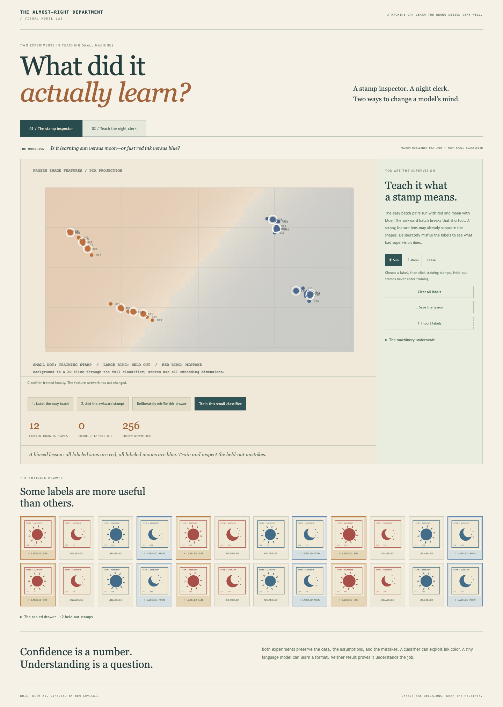

# Visual Model Lab — The Almost-Right Department

A stamp inspector and a night clerk: two experiments in what a small model actually learns.

[Open the live demo](https://bblevick.github.io/visual-model-lab/) · [50-second walkthrough](docs/media/demo.mp4) · [Specification](SPEC.md) · [Verification](docs/VERIFICATION.md)



## Run locally

Node 24 LTS and npm. No API keys or hosted application service.

```sh
npm ci
npm run dev
npm run typecheck
npm test
npx playwright install chromium webkit
npm run test:e2e
npm run build
npm run preview
```

TypeScript, TensorFlow.js MobileNet embeddings and a logistic head; optional Python/MLX trainer on Apple Silicon.

## How it works

### Stamp inspector

36 original deterministic stamp illustrations: 24 training and 12 held-out. True class is the generated sun/moon shape. Ink color varies independently across the full set. Users label only training stamps. The biased preset labels red suns and blue moons; the counterexample preset labels all training stamps. The explicit misfile action reverses existing training labels; it never changes held-out truth.

The backbone is MobileNet V1 0.25 224, extracted at `global_average_pooling2d_1` (256 dimensions) with input range −1 to 1. Actual normalized features are preserved in public/embeddings.json with backend/time metadata. Recompute loads bundled model shards and performs real inference in the browser; the backbone is never optimized.

`fitClassifier` fits a logistic head to labeled training vectors only. `confusion` evaluates untouched held-out vectors. Scores are not calibrated confidence. PCA uses the feature cloud only for visualization; the colored background is a two-dimensional slice through the full head, not the exact multidimensional boundary. Training-session JSON contains known training IDs and labels only, is versioned, and is capped at 100 KB.

### Night clerk / real LLM adapter training

The public mode displays a recorded, actually executed 60-step run and accepts report imports. Training itself requires Apple Silicon and the local controller. The model is HuggingFaceTB/SmolLM2-135M-Instruct at revision `12fd25f77366fa6b3b4b768ec3050bf629380bac`. MLX LoRA updates the last four layers with rank 8 adapters; base weights remain frozen. Fixed seed 42, batch 2, prompt masking, maximum sequence length 128, steps 20/60/120 and bounded learning rates.

Original synthetic dispatch examples split streets across train (32), validation (8), and test (8). The report’s comparisons are four held-out greedy generations. Validation loss is sampled over two batches, not a claim about the entire distribution. Shared templates make this a formatting demonstration, not a general capability benchmark. A custom JSONL dataset can contain 12–500 unique user/assistant pairs, each content 1–600 characters and total under 1 MB. Splits are deterministic 70/15/15 with unique prompts.

`trainer/server.py` listens only on 127.0.0.1:8765. Vite proxies `/trainer` from the local UI at port 4197. Job-changing requests require the matching local Origin, JSON content type and per-process token. Arguments are allowlisted; one job can run at a time. Stop terminates only that job’s process group. Nothing is uploaded. The hosted Pages app does not connect to loopback.

API: GET `/trainer/health`, GET `/trainer/status`, POST `/trainer/train` (token, steps, learningRate, optional JSONL dataset), POST `/trainer/stop` (token). Reports record loss samples, before/after output, hashes, dataset counts, duration, model revision and adapter bytes. Report imports are supplied evidence, not independently verified training.

`npm run llm:setup` creates .venv, installs pinned Python dependencies and downloads the base model. `npm run llm` starts controller plus UI. The browser classification experience remains standalone. [Example trained adapter weights](artifacts/example-adapter) are retained with a [portability note](docs/example-adapter.md); the 270 MB base model and local training runs are ignored by Git.

## Recreate the demonstration

Install FFmpeg and Playwright Chromium, then run `npm run demo:capture`. This records the real interface into docs/media/demo.mp4 (50 seconds). Raw captures stay in ignored .artifacts/. The local media port is 4205.

## How this was built with AI

Ben requested this project, selected the local/free constraints, and asked for a distinct identity and a smaller-model handoff. Codex generated and iterated the code, fixtures, tests and media from those directions. The artifacts preserve actual checks and limitations; they do not imply every line was hand-written by Ben.

See [TASKS.md](TASKS.md) for bounded implementation tickets and [BUILD_LOG.md](BUILD_LOG.md) for observed fixes and evidence.

## Limits

Synthetic examples and a small formatting task. The model may already classify biased examples correctly. Intentionally reversed labels illustrate incorrect supervision explicitly. No pretrained weights are updated in vision mode. LLM mode trains real adapters on Apple Silicon; public hosting shows evidence, not a GPU training service. No broad quality, accuracy, calibrated probability or production-readiness claim.

Original code is [MIT licensed](LICENSE). Third-party models/libraries retain their terms; see [notices](THIRD_PARTY_NOTICES.md). GitHub Actions checks and deploys a static build with the repository base path. Local LLM training is never part of the hosted deployment or Linux CI.
